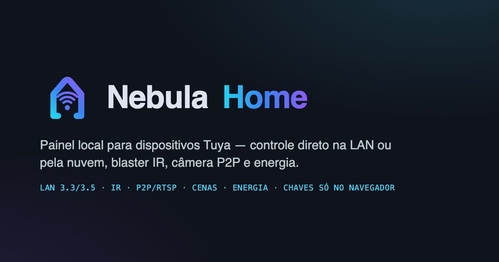
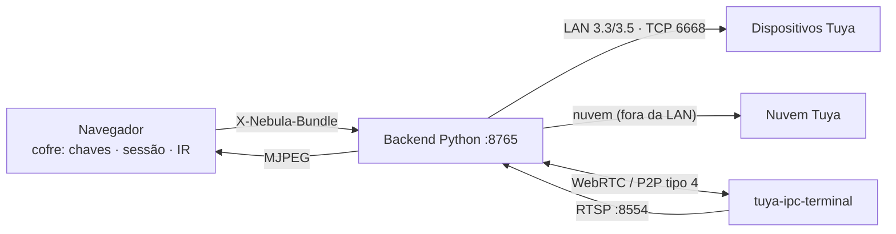

<p align="center">
  
</p>

<h1 align="center">Nebula Home</h1>

<p align="center">
  Painel local para dispositivos Tuya: controle LAN direto (protocolo 3.3/3.5),<br>
  blaster IR, câmera P2P/WebRTC decodificada localmente e medição de energia.<br>
  <strong>Backend Python sem estado + Next.js — as chaves nunca saem do seu navegador.</strong>
</p>

<p align="center">
  
  
  
  
  
</p>

---

## O que faz

- **Liga/desliga e telemetria** de lâmpadas e tomadas Tuya — pela LAN (protocolo
  3.3/3.5, TCP 6668) quando o aparelho está na rede, ou pelo gateway móvel da
  conta quando está fora dela, como no app.
- **Brilho, temperatura de cor e cor (RGB)** nas lâmpadas; **timer e medição de
  energia** (W/V/mA) nas tomadas que reportam.
- **Blaster IR**: dispara os códigos aprendidos/da nuvem (D-pad, rockers,
  teclado numérico, transporte, teclas de cor) com histórico real de disparos.
- **Câmera sem porta na LAN**: o feed chega por **P2P tipo 4 (KCP sobre relay
  TCP)**, é decodificado localmente e vira MJPEG no painel — com snapshot,
  gravação e ajustes de imagem.
- **Cômodos, cenas, cômodos compartilhados, malha, energia e avisos** lidos do
  gateway móvel da conta.
- **Login Tuya** por e-mail e senha (o QR entrega sessão parcial e não alimenta
  câmera/IR — por isso ficou fora da UI).
- **Comando em massa**: "Ligar tudo"/"Desligar tudo" respeitando o filtro da
  tela (`Ligar tudo` envia um comando por aparelho e agrega o resultado).

## Arquitetura: backend sem estado

O backend **não guarda nada**. As chaves (`localKey`), a sessão da conta e os
códigos IR vivem no **navegador** (vault) e viajam em **toda** requisição no
header `X-Nebula-Bundle` (base64url de um JSON). O servidor monta a resposta,
devolve e esquece.



- Bundle ausente, malformado ou velho **nunca derruba o servidor**: vira um
  bundle vazio e a API segue de pé.
- O processo guarda em memória só o derivado da rede (durante um scan) — e o
  scan **não cria devices**: quem existe é quem o navegador conhece (conta ou
  chave); a rede só empresta IP e versão de protocolo.
- Consequência honesta: limpar os dados do navegador **perde as chaves**. Por
  isso o painel tem **Exportar / Importar** — o vault sai num arquivo de texto
  que você controla.
- **Sessão ≠ chave.** A Tuya devolve pela API *quais* aparelhos existem (e o
  nome), mas **não** a `localKey` — ela só existe dentro do app. Sem chave, o
  aparelho aparece mas não é controlável, e o painel diz isso explicitamente em
  vez de mostrar uma lista morta.

## Rodar

Pré-requisitos: Python 3 com as dependências do backend, Node 20+, e (para
câmera) o `tuya-ipc-terminal` compilado em `backend/tools/tuya-ipc-terminal/`.

```bash
# backend (API + ponte de vídeo) em :8765
cd backend
pip install -r requirements.txt
python3 tuya_dash.py

# frontend (dashboard) em :3100
cd frontend
npm install
# opcional: NEXT_PUBLIC_API_BASE=http://127.0.0.1:8765 em .env.local
npm run build
npm start -- --port 3100
```

Copie `.env.example` para `.env` se precisar trocar região, timezone ou a
identidade do app (`TUYA_*`). Defaults funcionam sem nada.

Dashboard: <http://127.0.0.1:3100>. A raiz do backend (`:8765`) serve **só
API**.

A ponte de vídeo **sobe sozinha**: assim que chega uma sessão no bundle, o
backend lança `tuya-ipc-terminal serve` em segundo plano, descobre as câmeras e
publica RTSP em `127.0.0.1:8554`. Se falhar, o motivo aparece no card da câmera
(sessão expirada, sem câmera na conta, etc.).

## Endpoints

| rota | o que faz |
|---|---|
| `GET /api/devices?fast=1` | lista do cache do backend (~4 ms) |
| `GET /api/devices` | lista unificada com DPS real (~45 s) |
| `GET /api/status?id=` | DPS de um dispositivo |
| `GET /api/control?id=&action=` | liga/desliga/brilho/temp/cor/countdown/IR |
| `GET /api/ir/buttons` | códigos IR do vault |
| `GET /api/ir/cloud-keys` | baixa keys IR da nuvem (aprendidas opcional) |
| `GET /api/scan?go=1` | varredura Tuya da LAN |
| `GET /api/config` | região, país, blaster IR, câmera e fatos do P2P |
| `POST /api/cloud/login` | login por e-mail/telefone + senha |
| `GET /api/cloud/status` | sessão, RTSP, log do login |
| `GET /api/cam/sources` | câmeras publicadas pelo RTSP |
| `GET /api/cam.status` | telemetria do stream |
| `GET /api/cam.mjpeg?url=&w=` | vídeo em multipart MJPEG |

## Descoberta de dispositivos

Não há lista hardcoded. `tuya_registry` combina três fontes por autoridade:

1. **Nuvem** — diz *quais* devices existem, nome e categoria (base quando há
   sessão).
2. **LAN** — `tinytuya.deviceScan` diz o IP e a versão de protocolo. A rede tem
   prioridade sobre o IP que a nuvem informa (que erra com frequência).
3. **Chaves** — mandadas no bundle pelo navegador. O IP visto no scan volta em
   `/api/scan` e o front o guarda no bundle (só para quem já tem chave).

O `kind` sai da `category` da nuvem; sem categoria, cai para heurística com
acentos normalizados e por fim para `cloud`.

## Câmera

A câmera não expõe **nenhuma** porta na LAN (22/80/443/554/8000/8080/8443/8899
fechadas), então não existe RTSP local. O vídeo chega por **P2P tipo 4**:

- `isCloudP2P: false`, `transmission: "kcp"` — relay TCP + STUN/TURN
- H.264 1920×1080 + substream 640×360, `aesKey` de sessão entregue pela nuvem

Caminho: conta conectada → o backend detecta a sessão no bundle → sobe o
`tuya-ipc-terminal serve` (roda em RAM, sem `.tuya-data`) → WebRTC → RTSP em
`127.0.0.1:8554` → `tuya_rtsp` decodifica e re-emite MJPEG para o painel.

## Frontend

Next.js 16 (App Router) · React 19 · Tailwind 3 · shadcn/ui (Radix) · TanStack
Query 5 · TanStack Table 9 · Geist (fontes locais) · lucide-react.

Design **Obsidian Telemetry**: fundo `#0f131c`, cartões de vidro, ciano
`#4cd7f6` como primária, esmeralda/âmbar/coral para estados. Tokens em
`tailwind.config.js` + `globals.css`.

| rota | módulo |
|---|---|
| `/` | Dashboard: potência/tensão dos medidores + grade completa |
| `/iluminacao` · `/tomadas` | grades filtradas com comando em massa |
| `/ir` | controle IR: D-pad, rockers, teclado, histórico real de disparos |
| `/cameras` | hub de mídia: canais RTSP, player, diagnóstico do leitor |
| `/inventario` | conta Tuya + cofre (export/import/keys IR) + tabela de DPS |
| `/casa` | cômodos, cenas, energia, avisos e detalhe do aparelho |

SEO completo (Open Graph, Twitter, manifest, sitemap, robots) e marca (casa +
Wi-Fi) em SVG: um só desenho para topbar, favicon e imagem OG.

## Segurança

- **A `localKey` nunca persiste em disco**: viaja em cada requisição no header
  `X-Nebula-Bundle` (backend em memória) e é descartada depois da resposta.
  O dono do segredo é o navegador.
- O navegador guarda **uma chave só** (`nebula.bundle.v1`); qualquer outra
  escrita em `localStorage`/`sessionStorage`/cookies é bloqueada e limpa.
- A senha da Tuya vai apenas ao backend local (`127.0.0.1`), é usada para o md5 com a chave
  RSA da Tuya e **nunca é gravada**.
- O que fica salvo no navegador é exportável e apagável em um clique.
- Se você vazar uma `localKey` por acidente: abra o app Tuya Smart, remova e
  readicione o dispositivo — a chave é rotacionada. Depois invalide o backup
  exportado. Veja `SECURITY.md`.
- Identidade do app (`TUYA_CLIENT_ID`/`APP_KEY`/`APP_SECRET`) é engenharia
  reversa do Tuya Smart e pode ser sobrescrita por ambiente — veja
  `.env.example`. Sem afiliação com a Tuya.

> Projeto pessoal, sem afiliação com a Tuya. O `backend/tools/tuya-ipc-terminal`
> é um projeto de terceiros (MIT © seydx) incluído como fonte em
> `backend/tools/`. Use por sua conta: os protocolos são engenharia reversa do
> app oficial.

## Escopo deste repositório

Só `backend/` e `frontend/` são versionados. Artefatos de investigação do APK,
dados de runtime (chaves, sessão, códigos IR aprendidos) e scripts locais ficam
de fora por decisão do dono — o cofre de verdade é o seu navegador.
